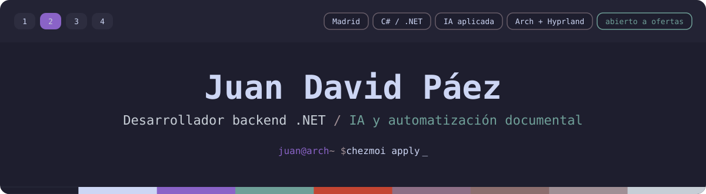

  

  
  
  
  

## Sobre mí

Soy Juan David, desarrollador backend **.NET** en Madrid. Construyo APIs que automatizan trabajo con documentos: maquetación de Word con **OpenXML** y generación de contenido con **IA (OpenAI)**, en producción para el sector universitario. Me importan las partes que suelen quedar para después: una arquitectura que aguante los cambios, una integración continua que detecte los errores antes que nadie y una documentación que otra persona pueda seguir.

Fuera del trabajo cuido mis propias herramientas: un escritorio Arch Linux + Hyprland gestionado con chezmoi y un teclado partido con firmware propio. Los dos son públicos, están documentados y se validan en CI. Los colores de esta página salen de esos dotfiles.

## Proyectos destacados

| Proyecto | Qué es | Tecnologías |
| --- | --- | --- |
| [**dotfiles**](https://github.com/kats76/dotfiles) | Mi entorno Arch Linux + Hyprland con una sola paleta, desde la pantalla de inicio de sesión hasta la terminal. El README es una guía por componente y la CI renderiza cada plantilla en un contenedor de Arch. | chezmoi, Lua, Bash, GitHub Actions |
| [**corne-mac**](https://github.com/kats76/corne-mac) | Distribución para macOS y firmware con un indicador RGB por capa para el teclado partido Corne v4.1. La CI compila el firmware para dos revisiones de la placa y publica las versiones. | C, QMK, Vial, Docker, GitHub Actions |
| [**TFGBoda**](https://github.com/kats76/TFGBoda) | *En desarrollo.* Plataforma SaaS multiinquilino para organizar bodas, con motor de recomendaciones. | Java 21, Spring Boot, PostgreSQL |

## Tecnologías

**Backend** 

**IA y documentos** 

**Datos** 

**Infraestructura y herramientas** 

**También**: Java y Spring Boot, JavaScript, Python.

## Cómo trabajo

- **Pull requests pequeñas y Conventional Commits**, para que el historial se explique solo.
- **CI en cada repositorio**: si una configuración o una compilación se puede romper, un pipeline lo comprueba antes.
- **Documentación pensada para quien nunca vio el proyecto**, con capturas y pasos que se pueden seguir.
- **Primero la arquitectura, después el framework**: separo la lógica de negocio de la base de datos y de la capa web para que un cambio de tecnología no obligue a reescribirla.

## Contacto

Estoy abierto a ofertas de backend .NET en Madrid o en remoto. La forma más rápida de contactarme es por [correo](mailto:juan.davidpaez@hotmail.com); también respondo en [LinkedIn](https://www.linkedin.com/in/juan-david-paez/).
